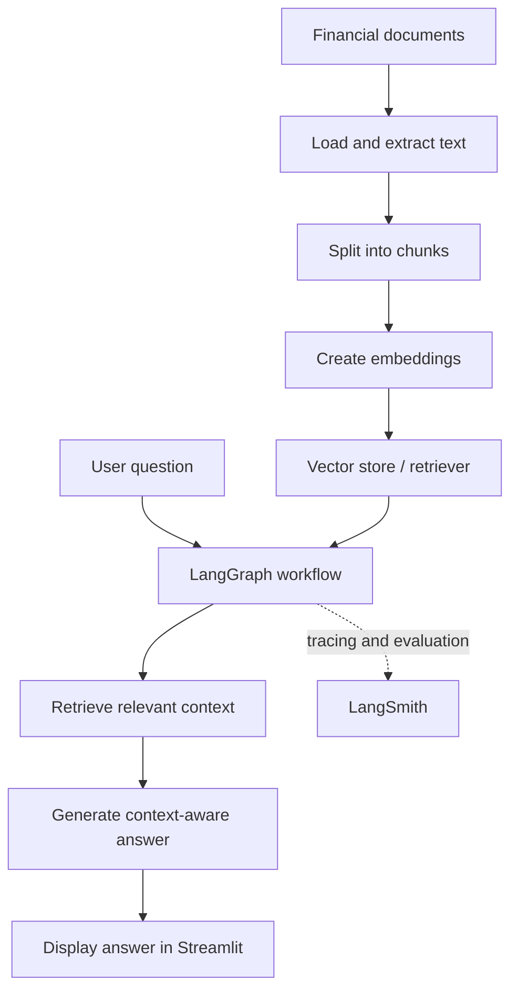

::: {align="center"}
# 🤖 AI Financial Advisor

### Week 4 · Applied AI \| RAG · LangGraph · LangSmith · Streamlit

**An AI-powered financial document assistant built as an end-to-end
applied AI/ML capstone.**

[](https://www.python.org/)
[](https://streamlit.io/)
[](https://www.langchain.com/langgraph)
[](https://www.langchain.com/langsmith)
[](#)

**[🚀 Open the Live
Demo](https://task-44-ai-agent-capstone-yb2krcesyxm3vkybqykymx.streamlit.app/)**
:::

------------------------------------------------------------------------

## 📌 Project Overview

The **AI Financial Advisor** is a prototype designed to explore how
generative AI can help users ask questions about financial documents and
receive answers grounded in retrieved information.

The Week 4 work brings together four related components:

-   **RAG Application (4.1):** document ingestion, chunking, retrieval,
    and context-aware response generation.
-   **LangGraph Workflow (4.2):** a structured, multi-step workflow for
    processing a question and producing a response.
-   **LangSmith Evaluation (4.3):** an evaluation dataset and
    observability workflow for inspecting and assessing responses.
-   **AI Agent Capstone (4.4):** a Streamlit interface that brings the
    project components together in a web application.

> **Important:** This is an educational prototype, not a certified
> financial adviser. Outputs may be incomplete or incorrect and should
> not be treated as investment, tax, or legal advice.

## 🎯 Objectives

-   Build a practical Retrieval-Augmented Generation (RAG) pipeline for
    financial-document question answering.
-   Understand how document chunking and retrieval affect the context
    supplied to a language model.
-   Organize processing steps into a LangGraph workflow.
-   Explore evaluation and observability for AI-generated responses
    using LangSmith.
-   Expose the prototype through a Streamlit web interface.
-   Document the architecture, setup, limitations, and potential next
    steps.

## 🧱 Week 4 Deliverables

  -----------------------------------------------------------------------
  Task                    Component               Purpose
  ----------------------- ----------------------- -----------------------
  **4.1**                 RAG Application         Load documents, split
                                                  text into chunks,
                                                  retrieve relevant
                                                  context, and generate
                                                  grounded answers.

  **4.2**                 LangGraph Workflow      Represent the agent's
                                                  processing as an
                                                  explicit workflow with
                                                  state and connected
                                                  steps.

  **4.3**                 LangSmith Evaluation    Organize test questions
                                                  and inspect/evaluate
                                                  response behavior.

  **4.4**                 AI Agent Capstone       Provide a user-facing
                                                  Streamlit app and
                                                  integrate the workflow
                                                  with the
                                                  document-answering
                                                  pipeline.
  -----------------------------------------------------------------------

## ⚙️ How It Works



*This is a high-level conceptual view. Refer to the implementation files
for the exact nodes, transitions, models, and storage configuration used
in the project.*

### 🔍 Component Breakdown

#### 1. Retrieval-Augmented Generation (RAG)

RAG combines retrieval from a knowledge source with language-model
generation. Rather than relying only on the model's general knowledge,
the pipeline retrieves relevant document chunks and supplies them as
context for answering a question.

Typical stages: 1. Load the source document(s). 2. Split the extracted
text into manageable chunks. 3. Generate embeddings for the chunks. 4.
Store and retrieve relevant chunks using the configured vector store. 5.
Pass retrieved context to the generation step. 6. Inspect whether the
response is supported by the available context.

#### 2. LangGraph Agent Workflow

LangGraph provides a way to represent processing as connected steps that
share state. In this project, the workflow is separated from the
Streamlit interface so the orchestration logic can be maintained
independently.

The workflow module is located in the **LangGraph Workflow** folder.
Check the code for the actual node names and routing implemented in this
version.

#### 3. LangSmith Evaluation and Observability

LangSmith supports tracing and evaluation of LLM applications. The
project includes a small evaluation dataset and a rule-based evaluation
approach to help inspect how the system handles representative
questions.

Useful evaluation areas include: - Correctness and relevance of
responses - Whether the answer is grounded in retrieved context -
Missing-information and unsupported questions - Failure points in
retrieval versus generation - Latency and behavior across test cases

Evaluation results depend on the test cases and evaluator configuration.
Review the actual LangSmith runs and results before reporting
performance metrics.

#### 4. Streamlit Web Application

Streamlit provides the user-facing interface for submitting a question
and viewing the AI agent's response. The capstone app is deployed
online.

**Live demo:** [AI Financial Advisor on
Streamlit](https://task-44-ai-agent-capstone-yb2krcesyxm3vkybqykymx.streamlit.app/)

## 🗂️ Repository Structure

The Week 4 work is organized into four components:

``` text
Week-4/
├── RAG Application/
│   └── # RAG implementation and supporting files
├── LangGraph Workflow/
│   ├── __init__.py
│   └── workflow.py
├── LangSmith Evaluation/
│   └── # Evaluation dataset, scripts, notes, or evidence
└── AI Agent Capstone/
    ├── app.py
    ├── requirements.txt
    └── # Streamlit deployment URL / project notes
```

> The tree above is a guide to the organization, not a replacement for
> the actual repository listing. Keep the real file and folder names as
> they appear in GitHub; add any notebooks, reports, datasets, or
> screenshots that are part of your submission.

## 🚀 Run the Streamlit App Locally

### Prerequisites

-   Python installed on your machine
-   Git, if you want to clone the repository
-   Internet access for downloading dependencies and any model assets
    used by the code
-   Any required model/API credentials configured securely, if your
    implementation uses them

### 1. Get the project files

Clone the repository or download it from GitHub. Then open the **AI
Agent Capstone** folder.

### 2. Create a virtual environment (recommended)

**Windows PowerShell:**

``` powershell
python -m venv .venv
.\.venv\Scripts\Activate.ps1
```

**Windows Command Prompt:**

``` bat
python -m venv .venv
.venv\Scripts\activate
```

**macOS / Linux:**

``` bash
python3 -m venv .venv
source .venv/bin/activate
```

### 3. Install dependencies

Run this from the **AI Agent Capstone** folder:

``` bash
pip install -r requirements.txt
```

### 4. Start Streamlit

``` bash
streamlit run app.py
```

Streamlit will print a local URL in the terminal. Open that URL in your
browser.

### 5. Check the workflow import

The app and the LangGraph workflow are maintained in separate folders.
If the app reports `ModuleNotFoundError` for the workflow module when
run locally, verify that the import path matches the real repository
structure and that the workflow package exposes the expected function.
The deployed app must also be configured with the correct main-file path
and dependency file.

## 🔐 Configuration & Security

-   **Never commit API keys, access tokens, passwords, or private
    credentials.**
-   If LangSmith tracing or another external API requires a key,
    configure it through Streamlit Secrets or environment variables
    rather than hard-coding it.
-   Do not upload private financial documents or personal financial
    information to a public repository.
-   Confirm that any data used in screenshots is fictional, public, or
    approved for sharing.

Example environment variable names (only if the code is configured to
use them):

``` text
LANGSMITH_TRACING
LANGSMITH_API_KEY
LANGSMITH_PROJECT
```

Use the exact variable names expected by your code and the current
LangSmith setup. Do not put real values in this README.

## 🧪 Testing & Evaluation

The project includes a LangSmith evaluation dataset named
**`Financial_RAG_Evaluation`**, containing representative
question-and-answer checks and a rule-based evaluation approach.

Suggested test categories:

  -----------------------------------------------------------------------
  Test type                           Example check
  ----------------------------------- -----------------------------------
  Direct fact                         Can the system retrieve a stated
                                      figure from the source document?

  Comparison                          Can it compare figures across two
                                      reporting periods when both are
                                      available?

  Multi-part question                 Can it answer each part using
                                      retrieved context?

  Missing information                 Does it clearly acknowledge when
                                      the document does not contain the
                                      requested fact?

  Unsupported claim                   Does it avoid inventing numbers or
                                      details that are absent from the
                                      source?

  Retrieval quality                   Are the retrieved chunks relevant
                                      to the user's question?
  -----------------------------------------------------------------------

Record actual outcomes, failure cases, and any latency observations in
your evaluation notes. Do not add accuracy percentages or claim that
every test passed unless those results were measured.

## 📊 Example Financial Knowledge Base

During development, example financial-report facts were used to exercise
the document-question-answering flow. The example data included:

-   FY 2025--26 revenue: **₹120 crore**
-   FY 2024--25 revenue: **₹100 crore**
-   Operating expenses: **₹78 crore**
-   Operating profit: **₹42 crore**
-   Total debt: **₹50 crore**
-   Example risk factors: government policy changes, project delays, and
    equipment-cost fluctuations

These are **example project figures**, not verified claims about a real
company. Use them for testing only if they match the document currently
loaded by the app. The employee count was not available in the example
source data, so the system should not invent one.

## 🖼️ Screenshots & Evidence

Add your own screenshots to a folder such as `assets/` and update the
links below. Good evidence includes:

1.  Streamlit app with a sample question and answer
2.  RAG pipeline or architecture diagram
3.  LangGraph workflow diagram
4.  LangSmith evaluation dataset or trace view
5.  A successful run and, if available, a useful failure-case trace

Suggested layout once the screenshots are added:

``` text
Week-4/
└── assets/
    ├── streamlit-app.png
    ├── rag-architecture.png
    ├── langgraph-workflow.png
    └── langsmith-evaluation.png
```

Then embed them in this README, for example:

``` markdown

```

Remember to blur secrets, private identifiers, and confidential document
content before publishing screenshots.

## ⚠️ Limitations

-   Generated answers can be wrong, incomplete, or overly confident.
-   Answer quality depends on the quality of the source documents,
    chunking strategy, retrieval, and prompt design.
-   The system may fail to answer questions that are ambiguous or
    unsupported by the available documents.
-   Evaluation quality depends on the coverage and reliability of the
    test dataset and evaluator.
-   The prototype is not a substitute for qualified financial advice or
    independent verification.
-   Model loading, memory use, latency, and availability depend on the
    environment and configured dependencies.

## 🔮 Future Improvements

-   Expand the evaluation dataset with more realistic questions,
    expected answers, and groundedness checks.
-   Add explicit handling for ambiguous and unanswerable questions.
-   Improve citations by linking answers to document names, page
    numbers, or retrieved passages.
-   Compare chunk sizes, embedding models, and retrieval settings
    systematically.
-   Track latency and failure cases across representative test runs.
-   Add support for more document formats and clearer upload validation.
-   Improve UI feedback, loading states, and error messages.
-   Add deployment and reproducibility checks for a clean setup.

## 🧠 Key Learnings

This project provided practical exposure to:

-   Designing a RAG pipeline for document-grounded question answering
-   Understanding the roles of embeddings, chunking, and retrieval
-   Separating application UI from workflow orchestration
-   Structuring multi-step AI processing with LangGraph
-   Using LangSmith concepts for tracing and evaluation
-   Packaging an AI prototype with Streamlit
-   Documenting limitations, test evidence, and future improvements

## 🏁 Week 4 Summary

Week 4 focused on moving from individual AI experiments toward a more
integrated application. The result is an **AI Financial Advisor
prototype** that brings together document retrieval, a structured agent
workflow, evaluation tooling, and a web interface.

**Live demo:** [Open the deployed Streamlit
application](https://task-44-ai-agent-capstone-yb2krcesyxm3vkybqykymx.streamlit.app/)

------------------------------------------------------------------------

::: {align="center"}
**Built as part of the Week 4 Applied AI/ML Internship**

*Learn · Build · Evaluate · Improve*
:::
